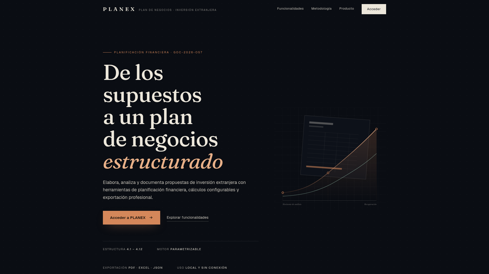
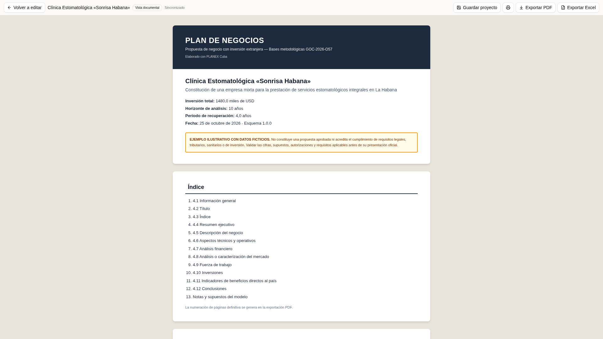
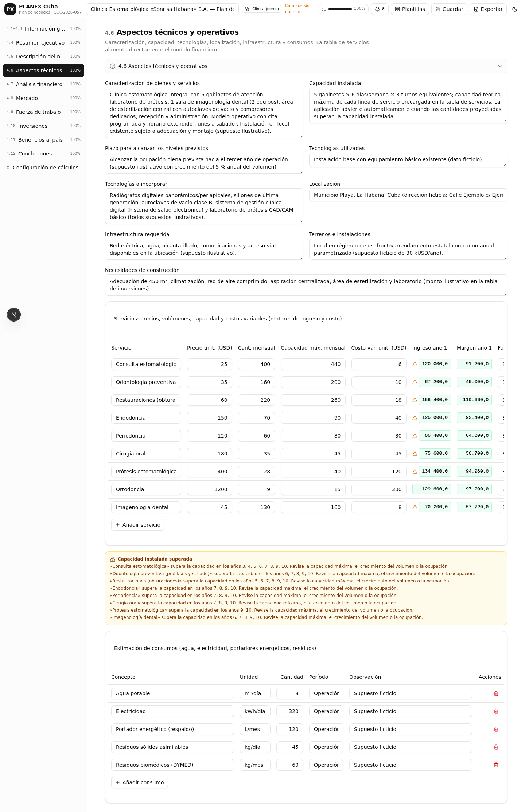
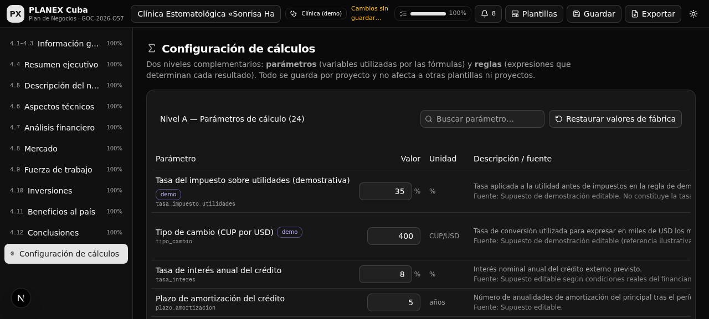

<div align="center">

# PLANEX Cuba

### Planes de Negocios de propuestas con inversión extranjera conforme a la Gaceta Oficial GOC-2026-O57

Aplicación web de página única para elaborar, calcular, validar y exportar Planes de Negocios
siguiendo textualmente las **Bases Metodológicas** publicadas en la Gaceta Oficial de la República
de Cuba, número extraordinario **GOC-2026-O57 de 9 de julio de 2026** (epígrafes 4.1 a 4.12).


[](https://github.com/Nardian90/PlanNegocios/actions/workflows/deploy.yml)

### Aplicación en línea

**https://nardian90.github.io/PlanNegocios/** — despliegue automático desde la rama `main`
vía GitHub Actions + GitHub Pages. La interfaz es 100% estática; la colaboración usa
**Supabase** desde el navegador (Auth + PostgreSQL con RLS + Realtime), sin backend propio:
los planes del espacio compartido se guardan y sincronizan en el servidor, protegidos por
autenticación real y políticas RLS.

**Flujo de vistas** (cada una con URL propia, navegación por hash sin 404):

| Vista | Ruta | Acceso |
|---|---|---|
| Landing de presentación | `#/` | Público |
| Acceso con alias de colaborador | `#/login` | Público |
| Proyectos compartidos | `#/proyectos` | Protegido |
| Editor del plan (4.1–4.12) | `#/editor?plan=…` | Protegido |
| Vista documental del plan | `#/preview?plan=…` | Protegido |

**Acceso**: inicio de sesión con el alias del colaborador (`Colaborador1` / `Colaborador2`)
y su contraseña. El alias se resuelve al correo interno de la cuenta y la verificación la
hace **Supabase Auth** en el servidor (correo + contraseña); tras autenticar se comprueba
que la cuenta pertenezca al espacio de trabajo autorizado. Las contraseñas no se guardan en
el navegador. Detalle en [`docs/supabase/`](docs/supabase/).

</div>

---

## Advertencia obligatoria

> **EJEMPLO ILUSTRATIVO CON DATOS FICTICIOS.** No constituye una propuesta aprobada ni acredita
> el cumplimiento de requisitos legales, tributarios, sanitarios o de inversión. Validar las
> cifras, supuestos, autorizaciones y requisitos aplicables antes de su presentación oficial.

La plantilla de ejemplo incluye esta advertencia en la aplicación, la previsualización,
el PDF y el libro Excel. La tasa impositiva del 35 %, el tipo de cambio y demás cifras de
demostración son **supuestos editables**, no tasas legales vigentes. El tipo de cambio
por defecto es **743 CUP/USD** (tasa ilustrativa del 2026-10-26, PENDIENTE DE VALIDACIÓN
OFICIAL: sustitúyala por la tasa vigente y documentable antes de un uso oficial). El
impuesto del 35 % es el supuesto demostrativo vigente, también pendiente de confirmación
tributaria para el caso concreto de cada proyecto.

---

## Tabla de contenidos

1. [Características](#características)
2. [Capturas de pantalla](#capturas-de-pantalla)
3. [Conformidad metodológica GOC-2026-O57](#conformidad-metodológica-goc-2026-o57)
4. [Motor de cálculo configurable](#motor-de-cálculo-configurable)
5. [Plantillas incluidas](#plantillas-incluidas)
6. [Exportación e intercambio](#exportación-e-intercambio)
7. [Colaboración multiusuario con Supabase](#colaboración-multiusuario-con-supabase)
8. [Arquitectura del proyecto](#arquitectura-del-proyecto)
9. [Requisitos e instalación](#requisitos-e-instalación)
10. [Despliegue](#despliegue)
11. [Guía de uso rápido](#guía-de-uso-rápido)
12. [Pruebas](#pruebas)
13. [Limitaciones conocidas](#limitaciones-conocidas)
14. [Documentación adicional](#documentación-adicional)

---

## Características

- **Estructura metodológica completa (4.1–4.12)**: información general, título, índice
  automático, resumen ejecutivo con cifras vinculadas al motor, descripción del negocio,
  aspectos técnico-operativos, análisis financiero, mercado, fuerza de trabajo,
  inversiones y cronograma, beneficios directos al país y conclusiones.
- **Motor de cálculo configurable de dos niveles**:
  - **Nivel A — Parámetros** (23): tasa de impuesto sobre utilidades, tipo de cambio,
    interés del crédito, período de gracia, plazo de amortización, inflación, crecimientos
    de precios/volumen/salarios, porcentajes de administración y mantenimiento, canon,
    públicos, capital de trabajo, aranceles… cada uno con valor, unidad, fuente, fecha de
    referencia y supuestos de demostración marcados.
  - **Nivel B — Reglas** (40): cada partida del estado de resultados es una regla con
    **expresión editable**, expresión de fábrica, historial de cambios, habilitar/deshabilitar
    y auditoría (variables usadas, valores actuales y error si falla).
- **Recálculo en cascada por grafo de dependencias**: al cambiar un parámetro o una fórmula,
  el sistema identifica las partidas afectadas y recalcula subtotales, totales, proyecciones
  plurianuales, flujo de caja, período de recuperación, resumen ejecutivo y exportaciones.
- **Editor de fórmulas seguro** (sin `eval()`): tokenizador, parser de árbol de sintaxis
  abstracta y evaluador propios, con validación en vivo de sintaxis, variables inexistentes,
  divisiones por cero, valores no finitos y dependencias circulares.
- **Plantillas de partida**: ejemplo completo de **Clínica Estomatológica** (datos ficticios
  coherentes) y plantilla **Default** general con ayudas metodológicas textuales de la Gaceta.
- **Exportaciones profesionales**:
  - **PDF** documental con portada, índice paginado, encabezados repetidos y texto seleccionable.
  - **Word (.docx) real y editable** con el mismo modelo documental que el PDF: estilos de
    Word, índice actualizable, tablas editables con encabezado repetido, pie «Página X de Y»
    y orientación apaisada solo en las tablas financieras anchas.
  - **Excel con fórmulas reales y referencias entre hojas** (no valores estáticos): 18 hojas,
    celdas de entrada y fórmulas diferenciadas, y recálculo automático al abrir el libro.
  - **JSON** con esquema versionado para guardar, intercambiar y reabrir proyectos.
- **Colaboración multiusuario en un espacio compartido (Supabase)**: dos colaboradores
  trabajan el mismo plan desde equipos y navegadores distintos con autenticación real,
  autoguardado con control de concurrencia, sincronización en vivo (Realtime), historial de
  versiones restaurable, registro de actividad con autoría, comentarios por sección y
  prevención de conflictos con resolución explícita (comparar / cargar remota / copia local /
  sobrescritura confirmada). Los datos se protegen con RLS en el servidor.
- **Persistencia local de recuperación**: copia de trabajo por plan en el navegador para
  reponer ediciones ante cierres inesperados o cortes de red; el servidor es la fuente de
  verdad y la UI nunca marca un cambio como guardado sin confirmación real. Temas claro/oscuro
  persistentes.
- **Vistas diferenciadas**: landing de presentación premium, acceso con alias de colaborador
  (Supabase Auth), panel de proyectos compartidos, editor protegido y **vista de documento con
  visor PDF real integrado** (pdf.js con worker propio): paginación, zoom, ajuste a
  ancho/página, búsqueda con resaltados, pantalla completa y descarga idéntica a lo mostrado
  (nunca un modal, nunca una aproximación visual).
- **Moneda de presentación del documento (CUP o USD)**: seleccionada desde la propia vista de
  documento, se guarda en el plan y afecta al visor, al PDF y al Word por igual. La tasa se
  lee del parámetro `tipo_cambio` existente (con fecha y fuente); la conversión se aplica una
  sola vez desde la moneda de origen, los porcentajes y cantidades no se convierten, los
  salarios permanecen en CUP conforme a la metodología 4.9 y los datos originales nunca se
  modifican.
- **Centro de ayuda y guía de trabajo (Diátaxis)**: vista pública `#/ayuda` con cuatro capas
  diferenciadas — tutoriales (recorrido completo verificable con la plantilla de clínica),
  guías prácticas paso a paso (12: tasa, moneda, financiación, capacidad, fórmulas, PDF,
  Word, versiones, restauración, permisos…), referencia (secciones 4.1–4.12, parámetros,
  monedas y unidades, fichas de fórmulas con ejemplo numérico, indicadores, validaciones,
  exportaciones) y conceptos (inversión vs gasto, ingresos vs caja, recuperación,
  advertencia vs incumplimiento normativo…). Búsqueda tolerante a acentos con fragmentos,
  enlaces directos por URL (`?capa=…&articulo=…`) y enlaces contextuales en los módulos
  (financiación, capacidad, moneda, resumen, configuración, visor, proyectos y colaboración)
  que abren OTRA pestaña para no perder el contexto de edición. Todo ejemplo numérico está
  rotulado como didáctico y reproducible con la tasa vigente.
- **Navegación integrada por vistas y pestañas (estilo GitHub, sin modales)**: la
  colaboración, el historial de versiones, la **comparación REAL de versiones campo a campo
  por sección**, los comentarios, los colaboradores con su rol y la resolución de conflictos
  viven en una vista dedicada `#/colaboracion?plan=…&tab=…` con URL reproducible; el
  diagnóstico del plan pasa a un panel lateral que no oculta el editor y el editor de
  fórmulas también dejó de ser modal. Pestañas con estado activo reconocible, orden estable
  y adaptación a pantallas estrechas; el único diálogo restante es la confirmación breve de
  restaurar una versión.
- **Icono propio de PLANEX**: marca vectorial original (documento + barras ascendentes sobre
  squircle pizarra-verde) con variantes `icon.svg`, `favicon.ico` (16/32/48), PNG 192/512 y
  `apple-touch-icon` (180, opaco), servidas y verificadas en el build; el favicon anterior
  genérico fue retirado por completo.
- **Validación y consistencia**: alertas clasificadas (error, inconsistencia, pendiente,
  supuesto, documental, legal) con navegación al apartado afectado; control de capacidad de
  servicios, insuficiencia/exceso de financiación, horizonte ≥ recuperación + 1 año y más.

## Capturas de pantalla

| Landing de presentación | Vista documental dedicada |
|:---:|:---:|
|  |  |

| Tema claro (editor) | Tema oscuro (editor) |
|:---:|:---:|
|  |  |

*La landing presenta el producto con dirección de arte editorial; la vista documental
(`#/preview`) muestra el plan como documento institucional con fondo neutro; las
capturas del editor corresponden a la sección de análisis financiero del ejemplo
Clínica Estomatológica. También hay una [captura del sitio desplegado en GitHub Pages
](docs/capturas/captura-github-pages.png), de la [vista de acceso](docs/capturas/vista-login.png)
y de la landing en [móvil](docs/capturas/landing-movil.png).*

## Conformidad metodológica GOC-2026-O57

| Epígrafe de la Gaceta | Implementación en PLANEX |
|---|---|
| 4.1 Información general | Formulario con declaración de responsabilidad del elaborador |
| 4.2 Título | Título editable y portada del documento |
| 4.3 Índice | Índice automático en previsualización, PDF y Excel |
| 4.4 Resumen ejecutivo | Cifras vinculadas al motor (no texto libre desactualizable) |
| 4.5 Descripción del negocio | Modalidad, objeto, vínculo PNDES/EDT, inversionistas y tabla de aportaciones con advertencia de derechos reales (Dirección de Patrimonio MFP) |
| 4.6 Aspectos técnico-operativos | Servicios con capacidad, ocupación y alertas de exceso; consumos |
| 4.7 Análisis financiero | Inversión total, financiación con detección de insuficiencia/exceso, proyección por años, impuesto, flujo de caja, recuperación y gráfico |
| 4.8 Mercado | Formulario metodológico del mercado y demanda solvente |
| 4.9 Fuerza de trabajo | Tabla en CUP con subtotales por grupo y entidad contratante |
| 4.10 Inversiones | Relación de inversiones, vehículos y cronograma con barra visual |
| 4.11 Beneficios directos al país | Tabla metodológica con acumulados calculados por el motor |
| 4.12 Conclusiones | Editables, con borrador automático a partir del modelo |

## Motor de cálculo configurable

El motor es **independiente de la interfaz** (`src/lib/planex/engine/`) y constituye la única
fuente de verdad del proyecto: tokenizador → parser (AST) → evaluador, **sin `eval()`** ni
ejecución de código libre.

**Operaciones y funciones admitidas**: `+ − * / ^`, paréntesis, porcentaje, comparaciones,
`AND`, `OR`, `NOT`, `IF` (con cortocircuito), `MIN`, `MAX`, `ABS`, `ROUND`, `SUM`, `POW`,
`LAG(partida, años)` para referencias a años anteriores y sumatorias por tabla
(`SUMA_SERVICIOS`, `SUMA_PERSONAL`, `SUMA_APORTACIONES`, `SUMA_INVERSIONES`).

**Dos capacidades distintas, ambas soportadas y probadas:**

1. **Cambiar un parámetro** — p. ej. la tasa del impuesto sobre utilidades del 35 % al 30 %:
   el impuesto del ejemplo pasa de 129,2 a 110,8 kUSD y toda la cascada (utilidad neta,
   flujo de caja, recuperación, resumen ejecutivo, exportaciones) se recalcula.
2. **Cambiar una fórmula** — p. ej. sustituir la base imponible de utilidades por ingresos:
   `impuesto = MAX(0, utilidad_antes_impuestos × tasa_impuesto_utilidades)` pasa a
   `MAX(0, ingresos_totales × tasa_impuesto_utilidades)` y el resultado es 290,3 kUSD
   (967,8 × 30 %) manteniendo la misma tasa del parámetro.

**Control de errores**: sintaxis inválida, variables inexistentes, división por cero,
valores no finitos, dependencias circulares y reglas deshabilitadas con dependientes.
Nunca se muestra un valor falso: la partida se marca y se explica el error, y las
exportaciones avisan antes de continuar.

## Plantillas incluidas

- **Clínica Estomatológica «Sonrisa Habana»** — ejemplo completo con datos ficticios coherentes: 9 servicios
  (ingresos año 1 = 967,8 kUSD), inversión de 1.480,0 kUSD (aportaciones 1.180,0 + crédito 300,0
  al 8 %, gracia de principal 1, amortización 5), UAI año 1 = 369,2 e impuesto 129,2 (35 % demo),
  depreciación por activo 117,125 kUSD/año, horizonte de 10 años ≥ recuperación (3,5 años por
  FCFF y 3,3 por FCFE) + 1, dividendos limitados por la caja acumulada y beneficios al país
  acumulados 4.399,6 kUSD (período completo) conciliados resumen↔tabla.
- **Centro de Diagnóstico «Imagen Habana» (generalización)** — segundo ejemplo de la prueba de
  generalización: otra actividad, horizonte de 8 años, sin crédito (FCFF = FCFE), escenario A
  (capacidad constante), tasa de demostración 30 %, un aporte en CUP y un activo con
  disponibilidad diferida (deprecia desde el año 3). Construido con las MISMAS reglas de
  fábrica: cero fórmulas de negocio nuevas. Inversión 2.265,0 kUSD, recuperación 4,6 años.
- **Default** — estructura metodológica completa con formularios vacíos, ayudas
  metodológicas por apartado (texto fiel de la GOC-2026-O57) y reglas activas. Sin datos
  emite avisos de pendiente en lugar de presentar resultados con datos inexistentes.

Las plantillas nunca se modifican: cada plan creado es un objeto independiente que puede
restaurar su plantilla de origen en cualquier momento.

## Exportación e intercambio

| Formato | Características |
|---|---|
| **PDF** (jsPDF + autoTable) | Doble pasada con índice de numeración real, secciones 4.1–4.12, encabezados repetidos en tablas, pies paginados, texto seleccionable, cifras del modelo en formato es-ES y advertencia de datos ficticios. Se genera desde el **modelo documental canónico** y en la **moneda de presentación** (USD/CUP) elegida |
| **Word** (docx) | Documento real y editable desde el mismo modelo canónico: portada, campo TOC actualizable (`updateFields`), estilos Heading1/2, tablas editables con encabezado repetido (`tblHeader`) y filas sin cortar (`cantSplit`), pie «Página X de Y», encabezado/pie en todas las secciones y **orientación apaisada solo donde hay tablas financieras anchas**. Sin imágenes ni rasterizados |
| **Visor integrado** (pdf.js) | Muestra el PDF real (mismos bytes que la descarga) con paginación, zoom, búsqueda con resaltado y pantalla completa; regeneración por huella con indicador de «actualizado / pendiente» y selector de moneda |
| **Excel** (xlsx-js-style) | 22 hojas con fórmulas reales (Depreciacion por activo, calendario de Deuda, FlujosCaja, Dividendos, Capacidad, BeneficiosPais…): el impuesto es `MAX(0; D$×Parametros!$C$)`; recálculo al abrir (`fullCalcOnLoad`, zip auditable); Controles con los cuatro niveles del diagnóstico; hoja «Reglas» documenta cada traducción y las no traducibles se exportan como valor con aviso explícito |
| **JSON** | Esquema versionado (`planex.schemaVersion` 2.0.0) con validación e importación segura sin ejecución de código del archivo; conserva recursos, deuda, escenarios, reglas, parámetros y análisis editados con autoría y huellas; las reglas desconocidas quedan deshabilitadas y marcadas |

## Colaboración multiusuario con Supabase

La misión **PLANEX-SUPABASE-001** añadió un espacio de trabajo compartido donde los
dos colaboradores autorizados (`Colaborador1` / `Colaborador2`) consultan, editan, guardan,
revisan y exportan los mismos planes desde computadoras y navegadores distintos.

- **Autenticación real** con Supabase Auth (correo interno + contraseña, resuelto desde el
  alias de la interfaz). La sesión la gestiona supabase-js (persistente, con refresco).
- **Espacio compartido**: panel `#/proyectos` con título, plantilla de origen, autor de
  creación, última actualización y autor, estado de elaboración, apertura, duplicado e
  importación de JSON como plan compartido. Refresco en vivo por Realtime.
- **Autoguardado por sección con concurrencia optimista**: cada escritura indica la versión
  sobre la que trabaja; si el otro colaborador guardó antes, el servidor NO aplica la
  escritura (0 filas) y la app preserva el trabajo local y ofrece resolución explícita
  (comparar campo a campo / cargar remota / copia local de respaldo / sobrescribir con
  confirmación). Nunca se fusionan cambios financieros incompatibles en silencio.
- **Sincronización en vivo**: cada sesión recibe por Realtime (autorizado con RLS) los
  cambios persistidos del otro, con identificación del autor; el motor recalcula las
  dependencias y la vista documental refleja siempre el estado vigente.
- **Historial y versiones**: instantáneas inmutables con autoría; restauración con copia de
  seguridad automática previa y aviso de sustitución; registro de actividad append-only.
- **Vista de Colaboración con pestañas** (`#/colaboracion`): resumen y actividad, historial,
  **comparación de dos versiones campo a campo** (URL reproducible con `?a=` y `?b=`),
  comentarios, colaboradores con su rol real y conflictos con resolución explícita —
  integrada en la navegación, no en ventanas modales.
- **Modo sin conexión**: aviso visible, cambios pendientes conservados (caché local de
  recuperación) y reintento controlado; al volver, si el otro creó una versión nueva, se pide
  resolución del conflicto antes de sobrescribir.
- **Seguridad**: la SPA usa **solo la clave publicable**; todas las tablas tienen RLS con
  condiciones reales de pertenencia al espacio, historial append-only y autoría sellada por
  el servidor. Ver [`docs/supabase/POLITICAS_RLS.md`](docs/supabase/POLITICAS_RLS.md).

Documentación completa: [`docs/supabase/`](docs/supabase/) — esquema de datos, políticas
RLS y su justificación, procedimiento de configuración (cuentas, espacio, variables de
compilación y GitHub Actions) y evidencia de las pruebas reales ejecutadas.

### Variables de compilación (no secretas)

La SPA se compila con variables públicas (véase `.env.example`): URL del proyecto Supabase,
clave **publicable** y correos internos de los dos colaboradores (el login pide el alias).
El flujo de GitHub Actions ya las define para el despliegue de Pages. **Nunca** se incluyen
claves `sb_secret_`/`service_role`, contraseñas de base de datos ni contraseñas de usuarios.

## Arquitectura del proyecto

```
src/
  app/                       Aplicación Next.js (App Router)
  components/
    planex/                  Shell, secciones 4.1–4.12, configuración, previsualización
    ui/                      Componentes de interfaz (shadcn/ui)
  hooks/                     Hooks compartidos
  lib/
    planex/
      types.ts               Modelo de datos único (proyecto 4.1–4.12, params, reglas, issues)
      engine/                Motor: tokenizer → parser (AST) → evaluator + grafo y orden topológico
                             + módulos estructurales: depreciacion, deuda, capacidad (recursos
                             compartidos y escenarios), dividendos, flujos/recuperación
                             (§4.3) y analisis (textos dinámicos con huellas §12.13)
      excel/traductor.ts     AST → fórmulas Excel (SUMIFS/SUMPRODUCT/SUM, LAG → columna anterior)
      templates/             reglas.ts (23 parámetros + 40 reglas), clinica.ts, centro.ts, default.ts
      model/                 Normalización/creación, % de cumplimentación y controles (diagnóstico §15)
      io/                    jsonio (JSON validado), xlsx (22 hojas), pdf (índice paginado), persistence
      store.ts               Estado global tipado (zustand)
tests/planex/                246 pruebas: motor (44) + 8 suites de auditoría (109) + XLSX (16) + PDF (7) + documento DOC-001 (46) + UX-002 ayuda/navegación/comparación/iconos/tasa (24)
docs/                        Informe de implementación, entregables de la auditoría y capturas
```

## Requisitos e instalación

**Requisitos**: Node.js 20.9+ (o Bun 1.1+). Las pruebas automatizadas requieren Bun.

```bash
# Clonar
git clone https://github.com/Nardian90/PlanNegocios.git
cd PlanNegocios

# Instalar dependencias (con npm, yarn, pnpm o bun)
npm install        # o: bun install

# Desarrollo (http://localhost:3000)
npm run dev        # o: bun run dev

# Compilación del sitio estático (genera out/)
npm run build

# Servir el sitio compilado localmente (equivalente al despliegue)
npm start

# Pruebas automatizadas (requiere bun)
bun test tests/planex/

# Análisis estático
npm run lint
```

La aplicación es un sitio estático (`output: export`): `npm run build` genera la carpeta
`out/` con HTML/CSS/JS autocontenidos. La ruta base se controla con la variable
`NEXT_PUBLIC_BASE_PATH` (vacía por defecto; el despliegue de GitHub Pages usa
`/PlanNegocios`). Una vez cargada, funciona sin conexión, no requiere servidores externos
y no envía información a ningún servicio remoto (los planes se guardan en `localStorage`
y viajan solo cuando el usuario exporta JSON/PDF/Excel).

## Despliegue

### CI de protección de main (configurado)

Cada pull request hacia main y cada push a main ejecutan el flujo
[`ci.yml`](.github/workflows/ci.yml): comprobación de tipos (`tsc`), lint, las 246 pruebas
unitarias/de integración y el build de producción estático, más la verificación de que los
iconos se sirven en el build. La rama `main` está protegida en el repositorio: exige pull
request con ese check en verde, prohíbe force pushes y borrados.

### GitHub Pages (configurado, automático)

El repositorio incluye el workflow [`.github/workflows/deploy.yml`](.github/workflows/deploy.yml):
cada push a `main` construye el sitio estático con Bun (con las variables públicas de Supabase
y el `basePath` de Pages) y lo publica en **https://nardian90.github.io/PlanNegocios/** mediante
GitHub Actions. La colaboración la resuelve Supabase desde el navegador; no se necesita
backend propio. La navegación interna usa rutas por hash (`#/`, `#/login`, `#/proyectos`,
`#/editor?plan=…`, `#/preview?plan=…`), de modo que ninguna vista produce 404 al recargar y
los recursos resuelven bajo la subruta del repo.

Configuración necesaria (ya aplicada en este repositorio):

1. **Settings → Pages → Source**: `GitHub Actions`.
2. El workflow adjunto se dispara en cada push a `main` (también manualmente desde la
   pestaña **Actions → Deploy to GitHub Pages → Run workflow**).

### Otros alojamientos

Al ser un sitio estático, `out/` puede servirse desde cualquier hosting:

- **Vercel** (opcional): importar el repositorio; detecta Next.js automáticamente. No
  requiere configuración adicional. Útil si se desea dominio propio o entornos de vista previa.
- **Netlify / Cloudflare Pages**: comando de build `npm run build`, carpeta a publicar `out/`.
- **Servidor propio**: `npm run build` y copiar `out/` a cualquier servidor web.

## Guía de uso rápido

1. **Landing y acceso**: abra el sitio; explore la presentación («Explorar funcionalidades»)
   y pulse «Acceder a PLANEX». En la pantalla de acceso introduzca su alias de colaborador y
   contraseña (Supabase Auth verifica en el servidor).
2. **Panel de proyectos compartidos**: cree un plan desde la plantilla «Clínica Estomatológica»
   (ejemplo completo) o «Default» (estructura general con ayudas), duplique uno existente o
   importe un JSON como plan compartido. El otro colaborador verá sus planes sin recargar.
3. **Explorar el modelo**: navegue por las secciones 4.1–4.12 en la barra lateral; las
   celdas calculadas muestran su fórmula al pasar el cursor y enlazan a la regla origen.
   El indicador de estado muestra siempre la verdad frente al servidor (pendiente/guardando/
   guardado/error/conflicto/sin conexión).
4. **Cambiar un parámetro**: abra «Configuración de cálculos», edite la tasa del impuesto
   (35 → 30 %) y observe el recálculo en cascada en la sección 4.7 — el otro colaborador lo
   verá en vivo.
5. **Cambiar una fórmula**: en la misma configuración, edite la expresión del impuesto
   (constructor visual o editor de texto) con validación en vivo y prueba con datos actuales.
6. **Previsualizar y exportar**: «Previsualizar plan» abre la vista documental dedicada
   (`#/preview`); desde su barra de acciones exporte PDF (documental), Excel (con fórmulas
   vivas) o JSON, y «Volver a editar» regresa a la misma sección de edición. Antes de exportar
   se confirma lo pendiente y se advierte de conflictos sin resolver.
7. **Colaborar**: «Colaboración» abre Historial de versiones, Actividad del plan y Comentarios;
   el estado de elaboración se cambia desde la barra superior.
8. **Cerrar sesión**: el botón de la barra superior regresa a la landing y limpia la sesión
   sin borrar los proyectos guardados.

## Pruebas

La suite automatizada cubre el motor de cálculo, los exportadores y el intercambio JSON:

| Suite | Casos | Cobertura |
|---|---|---|
| Motor | 44 | Valores esperados manuales, recálculo por parámetro, cambio de fórmula, sintaxis inválida, variables inexistentes, ciclos, división por cero, insuficiencia de financiación, horizonte, capacidad, flujos y caja de dividendos, round-trip JSON |
| Auditoría AUDIT-001 | 109 | Ocho suites espejo de la misión: regresión sobre cifras originales (§16.1/§3.1), depreciación por activo (§16.2), flujos y recuperación (§4.3/§16.3), capacidad derivada de recursos (§16.4), cascada tributaria 35 %→30 % (§16.5), reacción de los textos analíticos y trazabilidad (§16.6/§12.13), exportaciones PDF/XLSX/JSON (§16.7) y generalización con el Centro (§17) |
| Excel | 16 | Estructura (22 hojas), fórmulas reales por hoja, referencias entre hojas, coincidencia de valores con el motor, recálculo al cambiar la tasa, sin referencias rotas |
| PDF | 7 | Contenido, índice, cifras del modelo activo y advertencias |
| UX-002 (ayuda, navegación, comparación, iconos, tasa) | 24 | Integridad del contenido Diátaxis (ids, capas, enlaces internos, estructura de cada guía), tutorial con pasos verificables (dónde/acción/resultado), búsqueda relevante y estados vacíos, rutas `#/ayuda` y `#/colaboracion` por hash, comparación REAL de versiones campo a campo, política de modales (sin diálogos de colaboración/historial), iconos del build y metadatos, tasa 743 CUP/USD + impuesto 35 % con advertencia de validación pendiente |
| Documento DOC-001 (moneda/Word/consistencia) | 46 | Escenarios A–F de la misión: conversión USD/CUP con integridad de datos y huellas, nota documental de la tasa, salarios en CUP con equivalente, DOCX válido/actualizable/apaisado, consistencia modelo↔PDF↔Word, tablas multipágina con encabezados repetidos, inconsistencias visibles y sincronía del worker — [`docs/DOC001_EVIDENCIAS.md`](docs/DOC001_EVIDENCIAS.md) |
| Documento E2E (navegador real) | 19 | Visor PDF real con worker bajo el basePath, paginación, zoom, búsqueda con resaltados, selector de moneda con regeneración, descarga idéntica al visor (21 = 21 páginas), Word válido, persistencia de la moneda, móvil, temas y consola limpia — [`e2e/REPORTE-E2E-DOC.txt`](e2e/REPORTE-E2E-DOC.txt) |
| Colaboración E2E (dos navegadores reales) | 63 | Misiones SUPABASE-001 + UX-002: login con ambos alias, sesión restaurada, espacio compartido en dos sesiones, creación/apertura en vivo, edición recibida sin recargar con autor identificado, ediciones simultáneas, conflicto de la misma sección con resolución explícita EN LA VISTA INTEGRADA, preservación de ediciones no guardadas, persistencia de parámetros con recálculo en vivo (impuesto 116,1 con tasa 743), autoguardado tras recarga, reconexión, historial y restauración con copia automática, COMPARACIÓN REAL de versiones con URL reproducible, roles reales de los colaboradores, centro de ayuda Diátaxis con enlace directo, búsqueda y capas, icono servido y metadatos sin el favicon antiguo, exportaciones PDF/Excel/JSON desde el estado compartido, despliegue estático, consola — detalle en [`docs/supabase/EVIDENCIA_PRUEBAS.md`](docs/supabase/EVIDENCIA_PRUEBAS.md) y [`e2e/REPORTE-E2E.txt`](e2e/REPORTE-E2E.txt) |
| RLS/REST con JWT reales | 28 | Visibilidad por pertenencia, concurrencia optimista (versión caducada → 0 filas), denegaciones (anónimo, autoconcesión de membresía/roles, espacios ajenos, alias inmutable, mover secciones, borrar historial) — [`e2e/REPORTE-RLS-REST.txt`](e2e/REPORTE-RLS-REST.txt) |
| Vistas y acceso (enmienda) | 20 | Landing sin sesión, protección y redirección de vistas, cierre de sesión sin pérdida, previsualización dedicada, Atrás/Adelante, recargas sin 404, subruta, responsive, movimiento reducido — [`docs/ENMIENDA_VISTAS_Y_ACCESO.md`](docs/ENMIENDA_VISTAS_Y_ACCESO.md) |

Además se verificó de extremo a extremo en navegador: carga de plantillas, edición de
formularios y tablas, cascadas de recálculo, persistencia tras recarga, temas claro/oscuro
y ausencia de errores en consola. El detalle completo está en
[`docs/INFORME_DE_IMPLEMENTACION.md`](docs/INFORME_DE_IMPLEMENTACION.md).

## Limitaciones conocidas

1. **Recálculo en Excel**: se escribe fórmula + valor en caché y se fuerza `fullCalcOnLoad`;
   el recálculo real lo ejecuta Excel/LibreOffice al abrir el libro.
2. El **período de recuperación** se exporta a Excel como valor documentado (su interpolación
   no es portable como fórmula); la parte recurrente (acumulado) sí es fórmula.
3. **Aportes por año**: la tabla metodológica contempla 3 años de aportación (Año 1–3);
   ampliarla requiere reglas nuevas desde el editor.
4. La advertencia de datos ficticios permanece mientras el plan provenga de la plantilla
   «Clínica»; al crear desde «Default» no aparece.
5. Validaciones legales, tributarias, sanitarias y de mercado **pendientes de confirmación
   por el usuario** antes de cualquier uso oficial (tasa de impuesto, tipo de cambio,
   certificaciones del MFP, licencias MINSAP, estudios de demanda).
6. **Colaboración**: las contraseñas iniciales de los colaboradores fueron definidas por el
   propietario y la plataforma exige ≥ 6 caracteres por API; se fijaron mediante una
   actualización administrativa del hash verificando el login real (equivalente a cambiarlas
   desde el Panel). Cambie las contraseñas en Supabase (Authentication → Users) cuando lo
   desee: la app no las guarda en ningún sitio. La SPA usa solo la clave publicable; la
   protección real es la autenticación + RLS. La pertenencia al espacio y las cuentas se
   gestionan por la administración del proyecto Supabase (procedimiento en
   [`docs/supabase/CONFIGURACION_SUPABASE.md`](docs/supabase/CONFIGURACION_SUPABASE.md)).
7. **Cortes de red durante la edición**: los cambios pendientes se conservan y reintentan;
   si el otro colaborador guardó mientras tanto, la app pide resolución del conflicto (no
   fusiona datos financieros en silencio).

## Documentación adicional

- [`docs/AUDIT001_ENTREGABLES.md`](docs/AUDIT001_ENTREGABLES.md) — Entregables de la auditoría
  integral (misión PLANEX-AUDIT-001, §19 A–G): informe de defectos con causas y correcciones,
  modelo financiero documentado, plantillas finales, evidencias de las 176 pruebas,
  demostración de generalización, estado de las exportaciones y limitaciones.
- [`docs/supabase/`](docs/supabase/) — Integración de colaboración (misión PLANEX-SUPABASE-001):
  - [`ESQUEMA_DE_DATOS.md`](docs/supabase/ESQUEMA_DE_DATOS.md) — modelo relacional, secciones
    sincronizables, triggers y Realtime.
  - [`POLITICAS_RLS.md`](docs/supabase/POLITICAS_RLS.md) — políticas por tabla y justificación.
  - [`CONFIGURACION_SUPABASE.md`](docs/supabase/CONFIGURACION_SUPABASE.md) — procedimiento
    completo: migraciones, cuentas de colaborador, espacio compartido, variables de
    compilación y ajustes de Auth.
  - [`EVIDENCIA_PRUEBAS.md`](docs/supabase/EVIDENCIA_PRUEBAS.md) — mapa de las 23 pruebas de la
    misión con su evidencia real.
- [`supabase/migrations/`](supabase/migrations/) — migraciones SQL versionadas e idempotentes.
- [`e2e/`](e2e/) — arnés de pruebas de colaboración con dos navegadores reales e informes
  ejecutados (UI, RLS/REST, seguridad).
- [`docs/ENMIENDA_VISTAS_Y_ACCESO.md`](docs/ENMIENDA_VISTAS_Y_ACCESO.md) — Enmienda:
  landing premium, vistas con URL propia y previsualización dedicada.
- [`docs/INFORME_DE_IMPLEMENTACION.md`](docs/INFORME_DE_IMPLEMENTACION.md) — Informe completo
  de implementación y verificación: funciones, arquitectura, pruebas ejecutadas y resultados.
- [`docs/ejemplos/`](docs/ejemplos/) — Salidas del ejemplo Clínica Estomatológica:
  [Plan de Negocios en PDF](docs/ejemplos/Ejemplo_Clinica_Plan_de_Negocios.pdf) y
  [libro Excel con fórmulas](docs/ejemplos/Ejemplo_Clinica_Libro_con_formulas.xlsx).
- [`docs/capturas/`](docs/capturas/) — Capturas de la interfaz en temas claro y oscuro.

---

<div align="center">

**PLANEX Cuba** — elaborado conforme a la Gaceta Oficial GOC-2026-O57 (09/07/2026),
Ley 118 «De la Inversión Extranjera» y normas complementarias.

Uso con fines de elaboración metodológica. Las cifras del ejemplo son ficticias y los
supuestos tributarios, cambiarios y regulatorios deben validarse antes de cualquier
presentación oficial.

</div>
